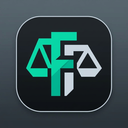

<div align="center">
  
  <h1>finnca</h1>
  <p>pencatatan keuangan double-entry yang serius, tapi tidak ribet</p>

[](LICENSE)
[](https://github.com/endrico-fn/finnca/releases)
[](https://github.com/endrico-fn/finnca/releases)
[](https://github.com/endrico-fn/finnca)
</div>

Aplikasi catatan keuangan pribadi: tulis transaksi, lihat arus kas dan laporan, semua data terenkripsi di komputermu sendiri.

## Install cepat

Butuh curl + bash (Linux) atau PowerShell 5.1+ (Windows), tanpa sudo kecuali paket `.deb`/`.rpm`.

```bash
curl -fsSL https://raw.githubusercontent.com/endrico-fn/finnca/main/scripts/install.sh | bash
```

```powershell
irm https://raw.githubusercontent.com/endrico-fn/finnca/main/scripts/install.ps1 | iex
```

Satu script untuk semua (`install`, `upgrade`, `uninstall`, `status`):

```bash
finnca status
finnca upgrade
```

Alternatif manual: `.AppImage` portable, `.deb` (`sudo apt install ./finnca_*.deb`), `.rpm` (`sudo dnf install ./finnca_*.rpm`), atau `_x64-setup.exe` di [Releases](https://github.com/endrico-fn/finnca/releases).

## Isinya

- **Catat** — jurnal double-entry, transfer cepat, multi-split, impor mutasi bank CSV.
- **Pahami** — dashboard, laba rugi, neraca, tren, cashflow, budget envelope, rencana cicilan.
- **Aman** — multi-vault ala Obsidian, SQLite + SQLCipher AES-256, kunci Argon2id, IDR & USD.

## Privasi

Semua data tersimpan lokal dan terenkripsi. Kamu bikin vault sendiri, tentukan sendiri foldernya, pakai password sendiri. Satu folder per vault — gampang di-backup, gampang dipindah.

## Dari source

Butuh [Node.js](https://nodejs.org), [pnpm](https://pnpm.io), dan [Rust](https://rustup.rs).

```bash
git clone https://github.com/endrico-fn/finnca.git
cd finnca
pnpm install
pnpm tauri dev   # coba-coba
pnpm tauri build # installer ada di src-tauri/target/release/bundle/
```

| Layer    | Tech                                            |
| -------- | ----------------------------------------------- |
| Depan    | Svelte 5, Tailwind v4, TypeScript               |
| Belakang | Rust, Tauri 2                                   |
| Data     | SQLite + SQLCipher, Argon2id                    |
| Hitungan | integer minor-units (`i64`) — bukan float       |

## Status

Proyek pribadi yang aktif dikembangkan. Silakan pakai; kalau ada yang aneh, buka issue.

## License

MIT
